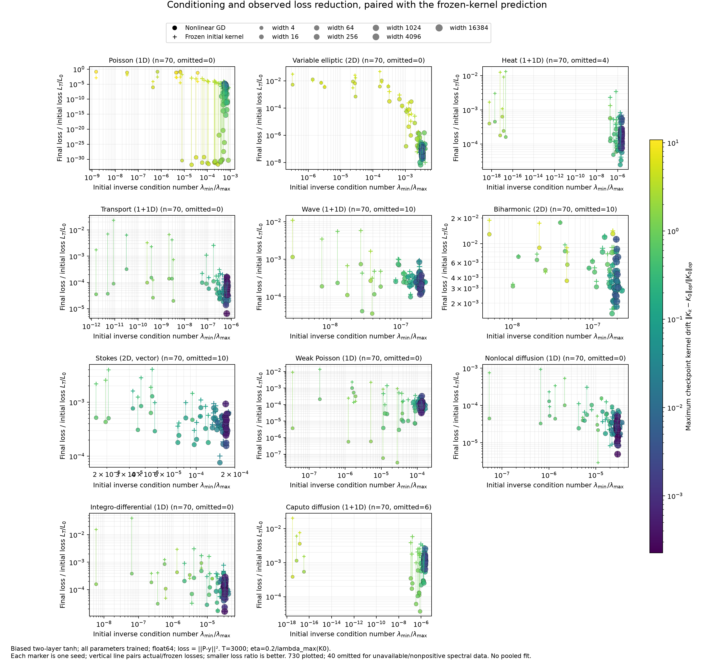

# Campaign findings: extensive_20260907

Completed 770/770 configured training runs and 11/11 reference kernels.

Configuration extensive_20260907: 11 PDEs, widths [4, 16, 64, 256, 1024, 4096, 16384], 10 seeds, 3000 full-batch GD steps. All parameters of the biased two-layer tanh network are trained in float64; loss is ||P-y||² and eta=0.2/lambda_max(K0).

Status counts: `{"complete": 770}`.

Values below are seed medians at the widest completed width for each PDE. Loss columns are final/initial loss; lower is better. Drift is the maximum recorded operator-norm change relative to the initial kernel, computed per seed before taking the median.

| PDE | Width | Seeds done/expected | Initial relative gap | GD loss ratio | Frozen loss ratio | Kernel drift |
|---|---:|---:|---:|---:|---:|---:|
| Poisson (1D) | 16384 | 10/10 | 0.0006 | 4.62e-06 | 5.63e-06 | 0.0155 |
| Variable elliptic (2D) | 16384 | 10/10 | 0.00327 | 6.91e-08 | 6.87e-08 | 0.0048 |
| Heat (1+1D) | 16384 | 10/10 | 2.32e-06 | 0.000189 | 0.00019 | 0.000839 |
| Transport (1+1D) | 16384 | 10/10 | 6.49e-07 | 6.22e-05 | 6.33e-05 | 0.000367 |
| Wave (1+1D) | 16384 | 10/10 | 1.88e-07 | 0.000207 | 0.000206 | 0.00175 |
| Biharmonic (2D) | 16384 | 10/10 | 1.96e-07 | 0.00522 | 0.00523 | 0.00486 |
| Stokes (2D, vector) | 16384 | 10/10 | 0.00017 | 0.000448 | 0.00045 | 0.000595 |
| Weak Poisson (1D) | 16384 | 10/10 | 0.000131 | 9.77e-05 | 9.75e-05 | 0.000722 |
| Nonlocal diffusion (1D) | 16384 | 10/10 | 2.86e-05 | 2.29e-05 | 2.29e-05 | 0.000432 |
| Integro-differential (1D) | 16384 | 10/10 | 3.16e-05 | 0.000124 | 0.000124 | 0.000474 |
| Caputo diffusion (1+1D) | 16384 | 10/10 | 2.13e-06 | 0.00128 | 0.00129 | 0.00213 |

Of the 770 completed runs, 770 reduce training loss and 767 reduce it by at least a factor of ten within the configured budget. These counts include all PDEs and widths and are descriptive, not a test of a common convergence rate.

Interpretation limits:

- These summaries describe completed numerical runs. Unfinished cells remain in the coverage denominator; missing work is not a failed convergence experiment.
- All registered PDE designs have analytic independence routes under the paper's assumptions. QMC estimates the gap; an unresolved or nonpositive numerical eigenvalue does not refute limiting positive definiteness.
- The spectral learning-rate rule and tested widths do not verify the theorem's deterministic derivative bounds, sufficient width inequality, or all-iteration guarantee.
- Positive definiteness alone does not predict finite-budget loss reduction: the relative gap, initial modal energy, finite width, and kernel drift also matter. The plot is descriptive and does not fit a pooled causal relationship across PDEs.
- The largest width reported for a PDE is the largest width with accepted completed data; its seed count can be incomplete. Full per-PDE/per-width coverage is in findings_by_problem_width.csv.
- Kernel drift and gap preservation are checked at recorded checkpoints. Kernel drift is normalized by the largest eigenvalue and can be small while exceeding the smallest eigenvalue.
- Weak, nonlocal, and Caputo experiments optimize their stored finite quadrature constraints. Training loss does not establish continuum solution accuracy or generalization.
- The existing main-paper conditioning run uses a different output-bias and loss convention. Its numerical values are not combined with this campaign.

Configuration SHA-256: `93f8907b121f8baa0c2a20a461b30df6e42e34ded852de0ca308593bc753a689`.
Report generated: 2026-11-15T22:32:02.513038+00:00. See findings.json for every expected cell and issue.
